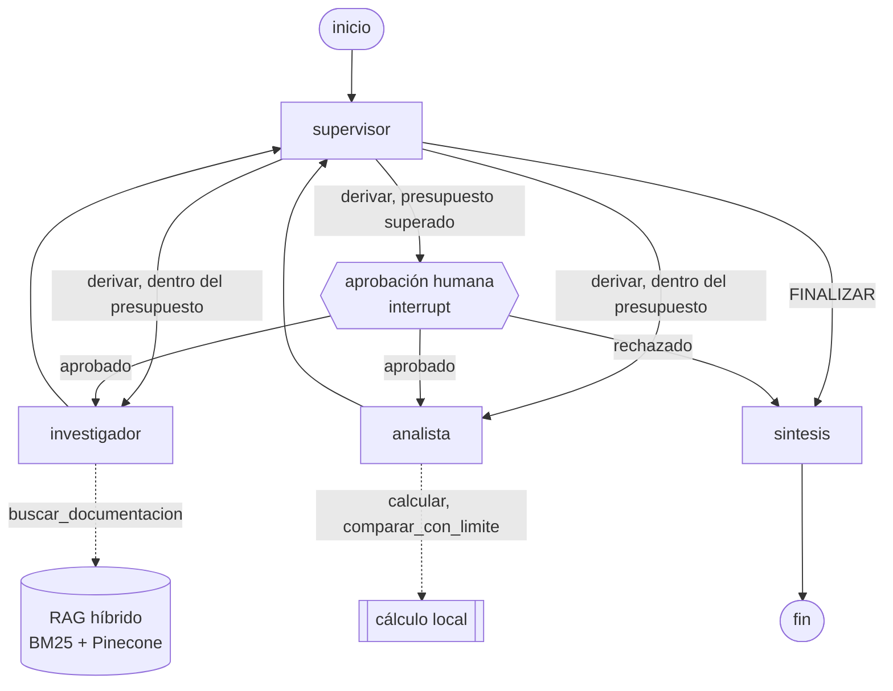

# Entrega final: Intelligence System sobre la documentación de httpx

Un equipo de agentes que responde preguntas técnicas sobre
[httpx](https://www.python-httpx.org/), la librería HTTP de Python. Un supervisor
reparte el trabajo entre un **investigador**, que busca en la documentación con
un RAG híbrido (BM25 + Pinecone), y un **analista**, que hace las cuentas. Todo
corre detrás de una API asíncrona: las tareas se encolan, se consultan por
polling y, si superan un presupuesto de costo, esperan la aprobación de una
persona. El estado de cada tarea vive en Redis, así que sobrevive a un reinicio
del servidor.

Junta lo construido en el curso: el RAG híbrido de la pre-entrega 4, el equipo
de agentes con supervisor de la pre-entrega 6 y la API con aprobación humana de
la pre-entrega 7.

```
docker compose up --build
```

---

## Arquitectura

```
                    ┌──────────────────────── contenedor api ────────────────────────┐
 cliente ──HTTP──>  │ FastAPI ──RPUSH──> cola ──BLPOP──> worker (asyncio, 5 en paralelo) │
   (polling)        │    │                                   │                          │
                    │    └──── job:<id> (Pydantic) <─────────┤ grafo.ainvoke(thread_id) │
                    └────────────────────────────────────────┼──────────────────────────┘
                                                             │
                     Redis 8: jobs, cola y checkpoints <─────┤  AsyncRedisSaver
                     Anthropic: supervisor, agentes   <──────┤  ainvoke
                     Pinecone + Google embeddings     <──────┘  IndexAsyncio / aembed_query
                     LangSmith: una traza por tramo de cada job
```

La API nunca corre el grafo: crea el registro del job en Redis, lo encola y
responde `202` en milisegundos. Un worker que vive en el mismo proceso (una
tarea de asyncio que arranca con la API) saca los pedidos de la cola y corre el
grafo con el `job_id` como `thread_id`. Cada paso del grafo queda guardado por
el checkpointer en Redis. Eso es lo que permite pausar una tarea para pedir
aprobación, apagar el servidor y retomarla después desde el mismo nodo.

Todo el camino de un pedido es asíncrono: las llamadas al modelo (`ainvoke`),
el embedding de la consulta (`aembed_query`, el cliente async de Google), la
búsqueda en Pinecone (`PineconeAsyncio` / `IndexAsyncio`), Redis
(`redis.asyncio`) y el checkpointer (`AsyncRedisSaver`). Mientras un job espera
una respuesta de red, el event loop atiende otros requests y otros jobs.

### El grafo de agentes



`docs/grafo.mmd` tiene el mismo grafo dibujado por LangGraph a partir del código
(`python scripts/diagrama.py`), para comprobar que este diagrama no quedó
desactualizado.

| Nodo | Qué hace |
|---|---|
| `supervisor` | Decide el próximo paso con salida estructurada (`Decision`: razón, agente, instrucción). Aplica una rúbrica de tres criterios para finalizar y tiene un tope de 6 decisiones. |
| `investigador` | Agente ReAct con una herramienta: la búsqueda híbrida en la documentación. Reporta datos y el archivo de donde salen. |
| `analista` | Agente ReAct con dos herramientas de cálculo. No ve la documentación: recibe los datos que reportó el investigador. |
| `aprobacion` | Si el supervisor quiere más derivaciones que `PRESUPUESTO_DERIVACIONES`, llama a `interrupt()` y el job queda en `WAITING_APPROVAL`. |
| `sintesis` | Redacta la respuesta final solo con lo que aportaron los especialistas, citando la fuente de cada dato. |

Cada especialista arranca con un historial nuevo: recibe la instrucción del
supervisor y nada más. No ve la conversación ni el razonamiento de otros
agentes, así que no se contamina con contexto que no le corresponde.

### El RAG híbrido

```
consulta ─> BM25 (en memoria, mismos fragmentos)             ─┐
                                                               ├─> RRF (0,3 / 0,7) ─> top-5
consulta ─> aembed_query ─> Pinecone (IndexAsyncio, async)    ─┘
```

BM25 encuentra coincidencias exactas (`PoolTimeout`, `SSL_CERT_FILE`,
`max_keepalive_connections`), que es justo lo que más se pregunta sobre una
librería. La búsqueda vectorial cubre las preguntas en lenguaje natural. El
`EnsembleRetriever` las corre a la vez y las fusiona por posición. Los pesos
salen de la evaluación de la pre-entrega 4: con 0,5 / 0,5 los empates se
resolvían a favor de BM25 y el fragmento correcto bajaba al segundo lugar.

---

## Cómo correrlo

Requisitos: Docker Desktop y las API keys de Anthropic, Pinecone, Google AI
Studio y LangSmith.

```
git clone https://github.com/diego2k-89/ai-engineering-coderhouse.git
cd ai-engineering-coderhouse/entrega-final
cp .env.example .env          # completar las keys
docker compose up --build
```

`docker compose` levanta tres servicios en orden:

1. **redis** (Redis 8, que trae RedisJSON y RediSearch para el checkpointer).
2. **ingesta**: crea el índice de Pinecone si no existe y sube los 83 fragmentos
   de la documentación si no están. Si ya están, termina en segundos.
3. **api**: arranca cuando Redis está sano y la ingesta terminó bien.

La API queda en <http://localhost:8000> y la documentación interactiva en
<http://localhost:8000/docs>.

### Endpoints

| Método | Ruta | Respuesta |
|---|---|---|
| `POST` | `/tasks` | `202` + `{job_id, estado}`. Body: `{"pregunta": "..."}` |
| `GET` | `/tasks/{job_id}` | El job: estado, respuesta, agentes que participaron, pausa pendiente, error, segundos |
| `POST` | `/tasks/{job_id}/approve` | `202`. Body: `{"aprobado": true}`. `409` si el job no está pausado |
| `GET` | `/health` | `{redis, worker}` |

Estados de un job: `PENDING → RUNNING → DONE | FAILED | WAITING_APPROVAL`.
Después de una aprobación vuelve a `PENDING`.

### Tests y pruebas

```
# Tests unitarios: sin keys, sin Redis, sin red (Python 3.12+)
python -m pip install -r requirements.txt
python -m pytest

# o dentro del contenedor
docker compose run --rm --no-deps api python -m pytest

# Las 5 pruebas de punta a punta, con la API levantada
python scripts/pruebas.py

# Aprobación humana con reinicio del servidor en el medio
python scripts/demo_hitl.py
docker compose restart api
curl http://localhost:8000/tasks/<job_id>        # sigue en WAITING_APPROVAL
python scripts/demo_hitl.py --aprobar <job_id>
```

---

## Cómo cumple la rúbrica

### Arquitectura y coherencia

- Una sola estructura por capas: `api/` (HTTP, cola, worker), `graph/` (estado,
  grafo, aprobación humana), `agents/` (supervisor y especialistas), `rag/`
  (ingesta y recuperación). Las dependencias van en un solo sentido:
  `api → graph → agents → rag`.
- El grafo no sabe nada de HTTP ni de Redis: recibe el checkpointer y el
  recuperador desde afuera (`construir_grafo(checkpointer, recuperador)`). Eso
  permite testear la API con un grafo falso y dibujar el grafo sin conexiones.
- El supervisor es el único que decide el recorrido; los especialistas no se
  hablan entre sí.

### Robustez técnica: async y Pydantic

- **Async de punta a punta**, sin `requests`, sin `time.sleep` y sin
  `asyncio.to_thread` en `app/`. Un test (`tests/test_estandares.py`) lo
  verifica sobre el código fuente. En las pre-entregas 6 y 7 la búsqueda en
  Pinecone era sincrónica y corría en un hilo aparte; acá usa los clientes
  async de Pinecone y de Google.
- **Pydantic en cada frontera** (`app/schemas.py`):
  - API: cada endpoint recibe y devuelve un modelo (`response_model`). Un pedido
    mal formado da `422` antes de llegar al código.
  - Herramientas: cada una declara su entrada con `args_schema` y arma su salida
    con un modelo. Si el modelo de lenguaje pasa un argumento con el tipo
    equivocado, el error se ve en el borde.
  - Estado: la decisión del supervisor (`Decision`, salida estructurada) y cada
    aporte de un especialista (`Contribucion`) se validan antes de escribirse.
  - Redis: el registro del job se valida al guardarlo y al leerlo.
- **Errores**: una excepción en el grafo deja el job en `FAILED` con el detalle,
  nunca en `RUNNING` para siempre. La búsqueda reintenta 3 veces y, si falla,
  le devuelve el error al agente como dato. Cada tramo tiene un tiempo máximo
  (`TIMEOUT_JOB_SEGUNDOS`). Un error en el bucle del worker no lo mata.

### Persistencia y observabilidad

- **Checkpointer**: `AsyncRedisSaver` guarda el estado del grafo en Redis bajo
  el `thread_id` de cada job. Una tarea pausada esperando aprobación sobrevive a
  `docker compose restart api` y se retoma desde el nodo de aprobación (ver
  [Resultados](#resultados)).
- **Trazas**: con `LANGSMITH_TRACING=true` cada tramo de cada job llega a
  LangSmith con un span por nodo, por llamada al modelo, por herramienta y por
  retriever (el ensemble y sus dos búsquedas). Cada traza lleva el `job_id` y la
  versión de los prompts como metadatos, y las etiquetas `iniciar` o `reanudar`.
- **Logs**: cada cambio de estado de un job queda en el log de la API con su
  `job_id` y su duración.

### Documentación y despliegue

- Este README, con el diagrama del grafo y el de componentes.
- Un comando: `docker compose up --build`. La ingesta es idempotente, así que el
  mismo comando sirve en una máquina limpia y en una donde ya se cargó el índice.
- La documentación de la API se genera sola en `/docs` a partir de los modelos.

### Entorno y estándares

- Python 3.12 en la imagen (`python:3.12-slim`); el código corre en 3.12 o más
  nuevo.
- Ningún modelo, índice, namespace ni URL escrito en el código: todo sale de
  variables de entorno (`app/config.py`, documentadas en `.env.example`). Un
  test lo verifica.
- Las keys solo están en el `.env`, que no se sube al repositorio. El código
  nunca imprime sus valores: si falta una, dice cuál.

---

## Resultados

Corridas del 28/10/2026 con `docker compose up --build`, modelo
`claude-sonnet-4-6`, en el proyecto `entrega-final` de LangSmith.

### Tests unitarios

```
docker compose run --rm --no-deps api python -m pytest
27 passed in 1.52s        (Python 3.12.16, dentro del contenedor)
```

### Las 5 pruebas de punta a punta

`python scripts/pruebas.py` manda las 5 preguntas a la vez y comprueba que
cada respuesta tenga el dato esperado.

| # | Prueba | Dato esperado | Resultado | Agentes | Latencia | Tokens | Costo |
|---|---|---|---|---|---|---|---|
| 1 | Límite de conexiones (250 vs. el máximo por defecto) | 150 | OK | investigador, analista | 27,99 s | 16.160 | $0,0635 |
| 2 | Excepción cuando no hay conexión libre en el pool | `PoolTimeout` | OK | investigador | 20,50 s | 8.604 | $0,0361 |
| 3 | Timeout por defecto × 3 intentos | 15 | OK | investigador, analista | 26,60 s | 13.890 | $0,0544 |
| 4 | Conexiones keep-alive como porcentaje de 50 | 40 | OK | investigador, analista | 27,73 s | 16.060 | $0,0622 |
| 5 | Variable de entorno para el archivo de certificados | `SSL_CERT_FILE` | OK | investigador | 18,67 s | 8.961 | $0,0355 |

Latencia, tokens y costo salen de LangSmith (una traza por prueba).

| Métrica | Valor |
|---|---|
| Pruebas que pasaron | 5 de 5 |
| Respuesta del `POST /tasks` | 43 ms la más lenta, con las 5 a la vez |
| Latencia p50 / p95 (LangSmith) | 26,6 s / 28,0 s |
| Latencia p50 / p95 (cliente, desde el POST hasta `DONE`) | 27,4 s / 28,4 s |
| Tiempo total de las 5 en paralelo | 28,4 s, lo mismo que la más lenta |
| Costo por ejecución | $0,050 promedio ($0,036 a $0,064) |

El p95 se calcula con las 5 latencias por rango más cercano: con 5 valores es
la más lenta. LangSmith muestra P50 y P99.

**Comparación con la pre-entrega 7** (mismas 5 preguntas, también en paralelo):
el p50 bajó de 30,9 s a 27,4 s, el p95 de 40,7 s a 28,4 s y el costo promedio de
$0,053 a $0,050. La diferencia principal son los prompts de los especialistas,
que ahora piden respuestas breves.

**Dónde se va el tiempo.** En la prueba 1 (supervisor → investigador →
supervisor → analista → supervisor → síntesis):

| Nodo | Segundos |
|---|---|
| supervisor (3 decisiones) | 11,8 |
| investigador (2 búsquedas) | 8,2 |
| analista | 4,3 |
| síntesis | 3,7 |

Las llamadas al modelo son casi todo el tiempo. Dentro de una búsqueda, BM25
tarda 0,00 s (está en memoria) y Pinecone entre 0,6 s y 1,2 s, con el
embedding de la consulta incluido. Para bajar la latencia, lo primero sería
usar un modelo más chico para el supervisor, que solo decide el ruteo y se
lleva el 42 % del tiempo.

**Los errores también quedan trazados.** En la captura de trazas aparecen 10
corridas en rojo, anteriores a estas. El modelo rechazaba el parámetro
`temperature` con un error 400. Los jobs terminaron en `FAILED` en 1 segundo, con
el mensaje de Anthropic en el campo `error` y en la traza. La corrección fue
dejar `temperature` como opcional (`ANTHROPIC_TEMPERATURE`, vacía por defecto).

### Aprobación humana con reinicio

`python scripts/demo_hitl.py` hace una pregunta que pide dos datos y dos
cuentas, así que el supervisor puede necesitar más derivaciones que el
presupuesto (2).

1. **Primer tramo (26,65 s).** El investigador buscó los dos datos (2
   derivaciones) y el supervisor quiso pasar al analista. El grafo se pausó en
   el nodo de aprobación y el job quedó en `WAITING_APPROVAL`, con el motivo, el
   agente siguiente y la instrucción que el supervisor le iba a dar.
2. **Reinicio.** `docker compose restart api`. El proceso de la API se detuvo y
   arrancó de nuevo.
3. **Después del reinicio**, `GET /tasks/{job_id}` seguía devolviendo
   `WAITING_APPROVAL` con la misma pausa: el estado del grafo estaba en Redis,
   no en la memoria del proceso.
4. **Aprobación.** `POST /tasks/{job_id}/approve` con `{"aprobado": true}`. El
   worker de la API nueva retomó el grafo desde el nodo de aprobación. Siguió el
   analista (3 × 5 = 15 s; 50 − 20 = 30 conexiones) y la síntesis, y el job
   terminó en `DONE`.

En LangSmith el job queda como dos trazas con el mismo `job_id`:

| Traza | Latencia | Tokens | Costo |
|---|---|---|---|
| `tarea-iniciar` (hasta la pausa) | 26,65 s | 14.030 | $0,0548 |
| `tarea-reanudar` (después de aprobar) | 11,81 s | 7.177 | $0,0278 |
| **Total del job** | 38,46 s | 21.207 | $0,0826 |

La entrada de `tarea-reanudar` es el `Command(resume={"aprobado": true})` que
manda el worker. La pausa no gasta nada mientras espera: entre los dos tramos
no hay ningún proceso ocupado con el job.

La misma pregunta, en otra corrida, se resolvió con 2 derivaciones y no se
pausó. El supervisor no siempre decide igual, porque las llamadas van sin
`temperature`. Para forzar la pausa en una demo: `PRESUPUESTO_DERIVACIONES=1`.

### Capturas

| Archivo | Qué muestra |
|---|---|
| [`00_docker_compose.png`](screenshots/00_docker_compose.png) | Los tres servicios levantados con un comando: Redis y la API corriendo, la ingesta terminada |
| [`01_trazas_pruebas.png`](screenshots/01_trazas_pruebas.png) | Las 5 pruebas en LangSmith, con latencia, tokens y costo |
| [`02_traza_detalle.png`](screenshots/02_traza_detalle.png) | El recorrido de la prueba 1 por el grafo y la respuesta final |
| [`03_traza_rag.png`](screenshots/03_traza_rag.png) | La búsqueda híbrida dentro del investigador: `EnsembleRetriever` con `BM25Retriever` y `PineconeRetriever` |
| [`04_stats.png`](screenshots/04_stats.png) | Monitoreo: cantidad de trazas, latencia y tasa de error |
| [`05_costos.png`](screenshots/05_costos.png) | Costo total, costo por traza y tokens |
| [`06_hitl_terminal.png`](screenshots/06_hitl_terminal.png) | La pausa, el reinicio de la API y el job todavía en `WAITING_APPROVAL` después del reinicio |
| [`06b_hitl_aprobacion.png`](screenshots/06b_hitl_aprobacion.png) | La aprobación: el worker de la API nueva retoma el grafo y el job termina en `DONE` |
| [`07_hitl_trazas.png`](screenshots/07_hitl_trazas.png) | Las dos trazas del job pausado: `tarea-iniciar` y `tarea-reanudar` |

---

## Decisiones y desvíos

- **LangSmith en lugar de Phoenix.** La consigna acepta cualquiera de los dos.
  LangSmith ya se usó en la pre-entrega 7 y traza LangGraph sin instrumentar
  nada.
- **Un job, un thread.** Cada tarea es una conversación nueva: el `thread_id` es
  el `job_id`. La persistencia que pide la consigna es la del estado ante un
  reinicio del servidor, que es justo lo que hace falta para la pausa de
  aprobación humana.
- **El worker vive dentro de la API**, como una tarea de asyncio. Para esta
  escala alcanza y simplifica el despliegue. Separarlo en otro proceso es
  cambiar el `CMD`: la cola ya está en Redis.
- **Python 3.14 en desarrollo, 3.12 en Docker.** El código no usa nada
  posterior a 3.12.
- **Dos avisos de deprecación conocidos.** `create_react_agent` se movió a
  `langchain.agents.create_agent` en LangGraph 1.0, y `langchain-community`
  (de donde sale `BM25Retriever`) dejó de mantenerse. Los dos funcionan; se
  dejaron porque son los que se vieron en el curso y migrarlos no cambia el
  comportamiento.
- **El costo de una aprobación** se mide en derivaciones, no en tokens: es lo
  que el supervisor controla y lo que se puede anticipar antes de gastar.

---

## Estructura

```
entrega-final/
├── app/
│   ├── api/          main.py (endpoints), jobs.py (registro y cola), worker.py
│   ├── graph/        state.py, grafo.py, hitl.py (aprobación humana)
│   ├── agents/       supervisor.py, research_agent.py, analyst_agent.py, comun.py
│   ├── rag/          documentos.py, recuperador.py (híbrido async), ingesta.py
│   ├── config.py     toda la configuración, desde variables de entorno
│   ├── schemas.py    todos los modelos de Pydantic
│   └── observability.py
├── data/             la documentación de httpx (20 archivos .md, licencia BSD-3)
├── scripts/          pruebas.py, demo_hitl.py, diagrama.py
├── tests/            sin keys ni red: API, grafo, RAG y estándares del código
├── docs/             grafo.mmd (generado)
├── trazas/           resultados de las corridas
├── screenshots/      capturas de LangSmith
├── Dockerfile
├── docker-compose.yml
└── .env.example
```
