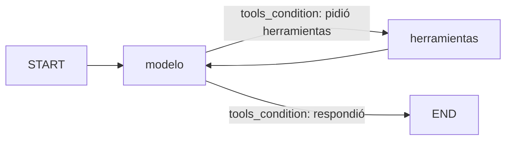

# Pre-entrega 5: agente cíclico con memoria persistente

Agente ReAct construido con LangGraph que responde consultas sobre clientes y
pedidos de una base simulada. El modelo decide solo qué herramienta usar y
cuándo; si una herramienta devuelve un error, lo lee y reintenta o pide una
aclaración. La conversación se guarda en SQLite por `thread_id`, así que el
agente recuerda el contexto entre preguntas y entre ejecuciones.

## Estructura

| Archivo | Qué hace |
|---|---|
| `herramientas.py` | Base simulada y las dos herramientas (`buscar_cliente`, `buscar_pedidos`) |
| `agente.py` | Estado, modelo con `bind_tools()` y el grafo |
| `main.py` | Escenarios de prueba, traza ReAct y modo `--preguntar` |
| `trazas/` | Traza de la última corrida, en `.json` y `.log` |

## El grafo



- **Nodo `modelo`**: Claude con las herramientas vinculadas por `bind_tools()`.
- **Nodo `herramientas`**: `ToolNode` de LangGraph.
- **Arista condicional**: `tools_condition` mira el último mensaje. Si trae
  `tool_calls` va a `herramientas`; si no, termina. No hay ningún if/else propio
  que decida la ruta: la decisión es del modelo.

El estado (`EstadoAgente`) hereda de `MessagesState` y agrega un contador de
llamadas a herramientas con `operator.add` como reducer.

## Cómo cubre cada criterio

| Criterio | Dónde |
|---|---|
| Autonomía | El modelo elige herramienta y argumentos; `tools_condition` solo lee esa decisión |
| Ciclo de retorno | Las herramientas devuelven los errores como datos (`no_encontrado` con sugerencias, `ambiguo` con coincidencias). El docstring le dice al modelo qué hacer en cada caso |
| Memoria | `AsyncSqliteSaver` + `thread_id` en la config |
| Bucles infinitos | `recursion_limit=10` por invocación; si se alcanza, se corta y queda registrado |
| Estado sucio | `trim_messages` limita a 20 los mensajes que viajan al modelo. El historial completo se sigue guardando |
| Asincronía | Herramientas `async`, `ainvoke` y `astream` en todo el flujo |

### Por qué las herramientas no lanzan excepciones

`ToolNode`, con su configuración por defecto, vuelve a lanzar las excepciones
de las herramientas y corta el grafo. Para que el modelo pueda reaccionar, cada
herramienta devuelve el error como parte del resultado. `handle_tool_errors=True`
queda como red de seguridad por si algo inesperado sí lanza.

## Escenarios de prueba

| Thread | Pregunta | Qué demuestra |
|---|---|---|
| sesion-1 | ¿Cuántos pedidos tuvo Distribuidora Norte y cuál fue el total? | Dos herramientas encadenadas |
| sesion-1 | ¿Y el último? | Memoria dentro del thread |
| sesion-2 | ¿Cuánto gastó en total Tecnosurr? | Reintento ante error de tipeo |
| sesion-2 | ¿Cuáles son los pedidos de Acme? | Pide aclaración ante ambigüedad |
| sesion-2 | El de Rosario. | Resuelve la aclaración con el contexto |
| sesion-3 | ¿Y el último? | Aislamiento entre threads |

## Cómo correrlo

Requiere Python 3.12 o superior. Desde la raíz del repo:

```bash
python -m venv .venv
.venv\Scripts\activate                                # Windows
python -m pip install -r preentrega-5/requirements.txt
copy preentrega-5\.env.example preentrega-5\.env       # y completar ANTHROPIC_API_KEY
cd preentrega-5
python main.py
```

Para ver que la memoria sobrevive a reiniciar el programa, después de correr
los escenarios:

```bash
python main.py --preguntar sesion-1 "¿Y cuál fue el primero?"
```

`checkpoints.sqlite3` se genera al correr y no se versiona.

## Resultados

La traza completa está en [`trazas/traza_react.json`](./trazas/traza_react.json)
y [`trazas/traza_react.log`](./trazas/traza_react.log).

| Escenario | Llamadas a herramientas | Qué hizo el agente |
|---|:---:|---|
| Distribuidora Norte | 2 | `buscar_cliente` y después `buscar_pedidos(102)`: 3 pedidos, $14.500 |
| ¿Y el último? | 0 | Respondió el pedido 5012 con lo que ya tenía en el historial |
| Tecnosurr | 3 | Recibió `no_encontrado` con la sugerencia "TecnoSur SA", reintentó con ese nombre y siguió con los pedidos: $26.250 |
| Acme | 1 | Recibió `ambiguo` y preguntó cuál de los dos, sin elegir uno |
| El de Rosario | 1 | Fue directo a `buscar_pedidos(104)`: el id lo sacó del resultado ambiguo anterior |
| ¿Y el último? (sesion-3) | 0 | Dijo que no tenía contexto y pidió el nombre del cliente |

Después, en un proceso nuevo, `python main.py --preguntar sesion-1 "¿Y cuál fue
el primero?"` respondió el pedido 5001 sin llamar a ninguna herramienta: el
historial se recuperó de `checkpoints.sqlite3`. Queda registrado en
[`trazas/persistencia.log`](./trazas/persistencia.log).

Corrí los escenarios dos veces. En las dos, cada escenario hizo las mismas
llamadas a herramientas y llegó a la misma respuesta; cambió solo la redacción
(por ejemplo, en una corrida el agente escribió su razonamiento antes de la
primera llamada y en la otra no).

### Qué observé

- **El ciclo de retorno funciona por el docstring.** El modelo leyó el error
  `no_encontrado`, vio una sugerencia clara y reintentó solo. Ante `ambiguo`,
  en cambio, preguntó. Es la conducta que describe el docstring de
  `buscar_cliente` para cada caso.
- **La memoria ahorra llamadas.** En "¿Y el último?" el agente no volvió a
  consultar la base: los pedidos ya estaban en el historial del thread.
- **Agregó información que no le pedí.** En Tecnosurr aclaró que el total
  incluye un pedido cancelado y dio el monto sin él. El docstring de
  `buscar_pedidos` dice que el total incluye los cancelados; el modelo usó ese
  dato para avisarlo.
- **El recorte de mensajes no se llegó a activar.** El thread más largo
  (sesion-2) terminó con 16 mensajes, por debajo del límite de 20. El recorte
  está para conversaciones más largas que estos escenarios.
- **Ninguna pregunta se acercó al `recursion_limit`.** El caso más largo
  (Tecnosurr) usó 7 pasos de 10.
