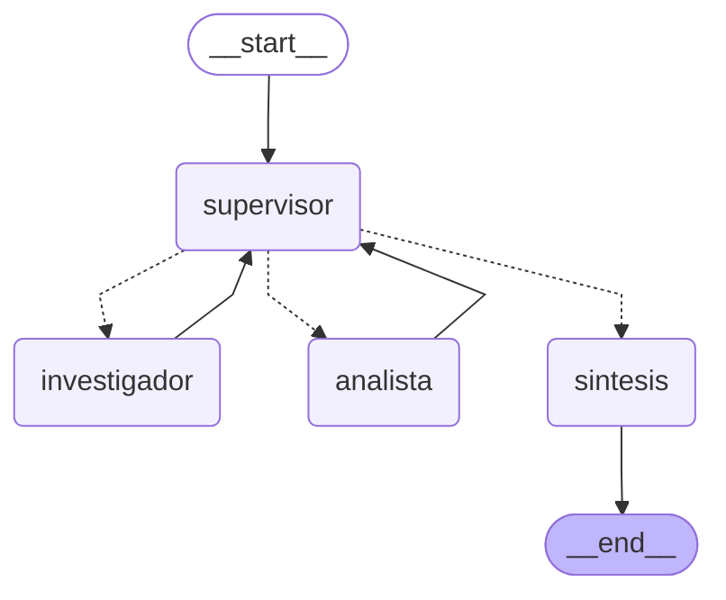

# Pre-entrega 6: orquestador multi-agente

Un supervisor recibe preguntas técnicas sobre httpx y las resuelve delegando en
dos especialistas:

- **Investigador**: busca datos en la documentación de httpx, sobre el índice
  de Pinecone que armé en la pre-entrega 4.
- **Analista**: hace cuentas y compara valores contra límites.

El supervisor decide en cada paso a quién derivar y con qué instrucción, y
cuándo la respuesta está completa. Al final, un nodo de síntesis redacta la
respuesta con lo que aportó cada uno.

## Estructura

| Archivo | Qué hace |
|---|---|
| `state.py` | `EstadoEquipo`: el estado compartido, con el registro de quién aportó qué |
| `agents/research_agent.py` | Investigador (`create_react_agent` + `buscar_documentacion`) |
| `agents/analyst_agent.py` | Analista (`create_react_agent` + `calcular` y `comparar_con_limite`) |
| `agents/supervisor.py` | Supervisor: decisión estructurada, rúbrica y freno de pasos |
| `agents/comun.py` | Cómo se invoca a un especialista y se registra su aporte |
| `graph.py` | Arma el grafo |
| `main.py` | Preguntas de demostración y traza |
| `demo.ipynb` | Recorre la traza paso a paso, sin necesidad de keys |
| `trazas/` | Traza de la última corrida, en `.json` y `.log` |

## El grafo



El diagrama sale del grafo compilado con `python main.py --mermaid`
(`graph.get_graph().draw_mermaid()`), que lo guarda en [`grafo.mmd`](./grafo.mmd).
Las flechas punteadas son la arista condicional del supervisor; las sólidas,
las fijas.

Usé el texto Mermaid en vez de `draw_mermaid_png()` porque el PNG se genera llamando a un
servicio externo, y GitHub ya dibuja el Mermaid en el README.

## El estado

`EstadoEquipo` hereda de `MessagesState` y agrega:

| Campo | Para qué |
|---|---|
| `siguiente_agente` | A quién deriva el supervisor |
| `instruccion` | La tarea concreta para ese agente |
| `contribuciones` | Lista de aportes: paso, agente, instrucción, herramientas usadas y resultado |
| `decisiones` | Cada decisión del supervisor con su razón |
| `pasos` | Contador de decisiones, para el freno |
| `tarea_completa` | Lo marca la síntesis al terminar |

`contribuciones` y `decisiones` usan `operator.add` como reducer: cada nodo
agrega lo suyo sin pisar lo anterior. Así queda registrado qué aportó cada
agente y en qué orden.

## Por qué esta topología

Elegí un **supervisor jerárquico** (estrella) en vez de una cadena fija
investigador → analista:

- **No todas las preguntas necesitan a los dos.** "¿Qué excepción lanza httpx
  si no consigue conexión del pool?" se resuelve solo con el investigador. Con
  una cadena fija, el analista correría igual sin nada que calcular.
- **Permite corregir.** Si el investigador no encuentra un dato, el supervisor
  le puede pedir otra búsqueda con otra instrucción. En una cadena, el error
  seguiría de largo hasta el final.
- **Un solo punto de decisión.** Los especialistas no se hablan entre sí; todo
  pasa por el supervisor. Eso hace que el recorrido sea fácil de seguir en la
  traza y que haya un único lugar donde vive el criterio de "terminado".

Cada especialista tiene solo sus herramientas: el investigador no puede
calcular y el analista no puede buscar. Eso obliga a que los datos salgan de la
documentación y las cuentas de una herramienta, y no de la memoria del modelo.

## Cómo se manejan los conflictos

1. **El supervisor es el único que decide.** Si dos aportes no cierran, no hay
   negociación entre agentes: el supervisor ve las contribuciones y deriva una
   corrección al agente que corresponde.
2. **Rúbrica antes de finalizar.** El prompt del supervisor exige tres cosas
   para cerrar: cada dato tiene su fuente en la documentación, cada cuenta la
   hizo el analista, y las contribuciones no se contradicen ni dejan partes sin
   responder. La decisión sale como un objeto estructurado (`Decision`) con la
   razón citando la rúbrica, y el campo `siguiente` es un `Literal`, así que no
   puede derivar a un agente que no existe.
3. **Prioridad de la fuente.** Si el analista usa un valor distinto al que
   reportó el investigador, manda el del investigador, porque es el que sale de
   la documentación. La síntesis solo puede usar datos de las contribuciones.
4. **Datos faltantes.** Si el investigador no encuentra algo después de dos
   intentos, el supervisor puede cerrar y la síntesis informa qué faltó, en vez
   de completarlo con una suposición.

## Cómo se evitan los problemas típicos

| Problema | Medida |
|---|---|
| Supervisor infinito | `MAX_PASOS = 6` decisiones por pregunta; al llegar, pasa a la síntesis. Además, `recursion_limit=20` en el grafo y `8` dentro de cada especialista |
| Contaminación de contexto | El investigador recibe solo la instrucción. El analista recibe la instrucción y los resultados del investigador. Ninguno ve la conversación completa ni el razonamiento interno del otro |
| Especialista trabado | Si un especialista llega a su límite de pasos, se registra como resultado y el supervisor decide qué hacer, en vez de cortar todo |
| Código arbitrario en `calcular` | La expresión se evalúa recorriendo el árbol de `ast` y solo acepta números y operadores aritméticos. `eval()` ejecutaría cualquier cosa que escriba el modelo |

## Cómo correrlo

Requiere Python 3.12 o superior y el índice de Pinecone de la pre-entrega 4 ya
cargado. Desde la raíz del repo:

```bash
.venv\Scripts\activate
python -m pip install -r preentrega-6/requirements.txt
copy preentrega-6\.env.example preentrega-6\.env    # completar las tres keys
cd preentrega-6
python main.py
```

Una pregunta suelta:

```bash
python main.py "¿Cuál es el timeout por defecto de httpx? ¿Cuántos segundos son 3 reintentos?"
```

## Resultados

La traza completa está en [`trazas/ejecucion.json`](./trazas/ejecucion.json) y
[`trazas/ejecucion.log`](./trazas/ejecucion.log). [`demo.ipynb`](./demo.ipynb)
la recorre paso a paso.

| Pregunta | Recorrido | Herramientas | Tiempo |
|---|---|---|:---:|
| ¿Alcanzan las conexiones por defecto para 250? | supervisor → investigador → supervisor → analista → supervisor → síntesis | investigador: 2 búsquedas · analista: `comparar_con_limite` y 2 × `calcular` | 38,9 s |
| ¿Qué excepción se lanza si no hay conexión del pool? | supervisor → investigador → supervisor → síntesis | investigador: 2 búsquedas | 18,8 s |

**Primera pregunta.** El investigador encontró `max_connections = 100` en
`advanced/resource-limits.md` y citó la línea textual. El analista confirmó que
no alcanza, que faltan 150 conexiones (`250 - 100`) y que el límite cubre el 40%
del pedido (`100 / 250 * 100`). El supervisor cerró en la tercera decisión,
citando los tres criterios de la rúbrica.

**Segunda pregunta.** El investigador encontró `PoolTimeout` en
`advanced/timeouts.md`. El supervisor finalizó sin pasar por el analista porque
no había nada que calcular. Esta pregunta está para mostrar que el recorrido no
es fijo.

### Qué observé

Es una sola corrida, así que esto describe lo que pasó en ella, no un
comportamiento garantizado.

- **El supervisor decidió bien en las dos preguntas**, incluida la de no usar
  al analista en la segunda. En ninguna se acercó al límite de 6 decisiones.
- **El investigador buscó dos veces en las dos preguntas**, aunque la primera
  búsqueda ya traía el dato. Según su propia respuesta, lo hizo para confirmar.
  Es una llamada de más a Pinecone y a los embeddings por pregunta.
- **Los especialistas se salieron un poco de su rol.** El analista cerró con una
  recomendación que nadie le pidió (crear el cliente con
  `httpx.Limits(max_connections=250)`), y la síntesis la repitió. En la segunda
  pregunta, el investigador agregó un ejemplo de código con `pool=5.0` que no
  aparece en el fragmento recuperado. La síntesis no lo incluyó, pero muestra
  que la regla "no respondas de memoria" del prompt no alcanza para impedirlo
  del todo.
- **El supervisor repitió los datos en la instrucción del analista**, aunque el
  nodo ya se los pasa como contexto. No cambia el resultado, pero son datos
  duplicados en el pedido.
- **La rúbrica quedó visible en la traza.** Cada decisión de FINALIZAR cita los
  criterios que se cumplieron, lo que permite revisar por qué terminó.
